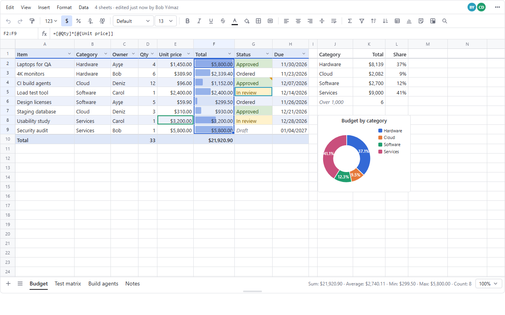

# Spreadsheets for YouTrack

A shared spreadsheet in YouTrack issues. Keep estimates, budgets, test matrices and release checklists in the issue they
belong to, and edit them together with the people working on the issue.

Spreadsheets for YouTrack adds a **Spreadsheet** section above the issue's activity stream (comments and history) in the projects the
app is attached to; collapse and expand it with the section header like other issue sections. The issue's options menu
(**Open spreadsheet**) shows the same spreadsheet in a large window.



## Features

- **Shared editing.** A cell is saved when you finish editing it (Enter, Tab or a click elsewhere), and other people see
  the change within a few seconds. Other people's selected cells are outlined in their color, and their avatars show in
  the bar. Rows and columns have stable IDs, so an edit lands on the right cell even when someone inserts or deletes
  rows at the same time.
- **Formulas.** 314 functions (292 separate implementations plus 22 alternative names such as STDEV for STDEV.S):
  math, statistics, logic, text, date and time, lookup (XLOOKUP, INDEX/MATCH, VLOOKUP), financial (PMT, NPV, IRR,
  XIRR…), dynamic arrays that spill (FILTER, SORT, UNIQUE, SEQUENCE…), LET and regular expressions. Relative, absolute
  and mixed references (F4 switches them), other sheets (`'Sheet 2'!A1`), whole columns (`A:A`), spilled ranges
  (`A1#`), named ranges and table references (`=SUM(Sales[Amount])`, `[@Price]*[@Qty]`). Autocomplete and argument
  hints while you type; click cells to insert references.
- **Tables.** Header row, banded rows, 7 color styles, total row, filter buttons with value lists and conditions,
  sorting, automatic expansion when you type next to the table, and formulas that fill a new table column. Total rows
  use SUBTOTAL, which leaves out rows hidden by a filter.
- **Formatting.** Number formats (number, currency, accounting, percent, scientific, date, time, duration, text and
  custom formats such as `#,##0.00 "€"` or `dd.mm.yyyy`), fonts, sizes, bold, italic, underline, strikethrough, text and
  fill colors, borders, alignment, wrap, merge and format painter. **Format cells…** (cell context menu or Format menu)
  sets the number format, alignment, font, borders and fill in one dialog. The currency button uses the currency symbol of your locale ($ when the app does not know the locale's currency).
- **Several ranges.** Ctrl+click or Ctrl+drag (Cmd on a Mac) adds cells, ranges, rows or columns to the selection, as in
  Excel. Formatting, Format cells, clearing, hiding, row heights and column widths, merging, fill down and right, and
  Ctrl+Enter act on all selected ranges, and the status bar totals them. Ranges over the same rows (or the same columns)
  are copied together as one block, so two columns far apart paste side by side; one copied cell pastes into all
  selected ranges. Cut, inserting and deleting rows and columns, sorting, filters and AutoSum work on one range at a time.
- **Conditional formatting.** 30 rule types: values, text, dates, duplicates, top/bottom N, above/below average, custom
  formulas, 2- and 3-color scales, data bars and an arrow icon set.
- **Data validation.** Dropdown lists (from items, a range or a named range), checkboxes, number, whole-number, date and
  text-length rules, and custom formulas. Rules are checked when a value is typed or picked from a list. A rule can
  reject a value or only warn, with your own message.
- **Charts.** Column, stacked column, bar, line, area, pie, doughnut and scatter, drawn from a range, redrawn when the
  data changes, and moved and resized on the sheet.
- **What-if analysis.** Solver (Data > Solver…): maximize, minimize or reach a value of an objective cell by changing
  variable cells, with ≤, =, ≥, integer, binary and AllDifferent constraints; Simplex LP (branch and bound for integers,
  sensitivity analysis), GRG Nonlinear (forward/central derivatives, Multistart) and Evolutionary methods with all their
  options; Show Iteration Results, Stop and continue-past-limit prompts; Answer, Sensitivity, Limits, Population,
  Feasibility, Feasibility-Bounds and Linearity reports as new sheets; models saved per sheet and Load/Save in cells.
  Goal Seek and the Scenario Manager (add, edit, delete, show, merge, summary) under Data > What-if analysis.
  Models and scenarios are kept in .xlsx files (hidden sheet-level `solver_*` names and `<scenarios>`).
- **Sheets, rows and columns.** Up to 50 sheets (add, rename, duplicate, move, color, delete). A sheet starts with
  100 rows and 26 columns and grows as you move or scroll past them (up to 20,000 rows and 200 columns). Insert and delete rows
  and columns (formulas follow), hide and unhide, resize and autofit, freeze rows and columns, gridlines on or off,
  zoom, and Sum, Average, Min, Max and Count of the selection.
- **Data tools.** Sort by several levels, filter, remove duplicates, split text to columns, find and replace (also in
  formulas and across sheets), and a fill handle that continues numbers, dates, month and weekday names, Q1 to Q4 and
  items such as "Item 1".
- **Files and clipboard.** Import `.xlsx` and `.csv` files (drop them on the bar or the grid, or use the menu) and
  download the workbook as `.xlsx` or a sheet as `.csv` (comma, semicolon or tab separated). Copy and paste with other spreadsheet apps carries values and
  basic formatting (and merged cells when pasting in); formulas are kept only when you copy and paste within the same page (not between the issue and the large window,
  between two issues or between browser tabs).
- **Notes and links.** Cell notes (orange corner) and links; Ctrl+click opens a link. Only `http`, `https` and `mailto`
  links open.
- **Change history.** Who changed which cells and when, with the old and new values. Editors can put the old values of
  an entry back, delete entries or clear the history. Undo and redo (Ctrl+Z / Ctrl+Y) cover your own changes since you
  opened the page.
- **Delete.** Clear cells, delete rows, columns and sheets, or delete the whole spreadsheet of an issue.
- **YouTrack look.** Uses the Ring UI color and font variables and follows the YouTrack theme (light or dark), not the
  operating system theme.
- Plain HTML, CSS and JavaScript. No external services, nothing loaded from the internet.

## Requirements

- YouTrack 2026.2 or later.
- Users who can read an issue can see its spreadsheet. Creating and editing needs the Update Issue permission in the
  project, or one of the project settings below.

## Installation

1. Build `spreadsheets-for-youtrack.zip` (see [Development](#development)).
2. In YouTrack, go to **Administration → Apps → Add app** and upload the ZIP file.
3. Attach the app to your projects: open the app in **Administration → Apps**, then **Projects → Manage projects**.

Uploading a newer ZIP replaces the installed version. The `name` in `manifest.json` (`spreadsheets-for-youtrack`) is the app's ID and
must not change. (Versions up to 1.2.2 were called Issue Sheets and used the ID `issue-sheets`; YouTrack treats the two IDs as different apps.) Spreadsheets are stored in the app's extension properties: download the ones you want to keep before
you remove the app.

## Settings

| Setting (project) | Effect |
| --- | --- |
| **Everyone who can see the issue can edit** | Off (default): users with the Update Issue permission can edit; users who can only read the issue can view. On: every signed-in user who can see the issue can edit (the guest account never edits). |
| **Groups that can edit spreadsheets** | Members can create and edit spreadsheets in the issues they can see, even without Update Issue. |
| **Groups that can only view spreadsheets** | Members never edit, even with Update Issue. Overrides the two settings above. |

Edit rights come from YouTrack's Update Issue permission in the issue's project (`User.hasPermission('UPDATE_ISSUE', project)`),
whichever role grants it (global, project or custom roles), never from role names; `Issue.isVisibleTo` must be true. YouTrack
apps cannot add their own permissions to the role editor, so the group settings above provide per-group control. The backend
checks this on every request, and an open spreadsheet switches between editing and view-only within seconds.

## Using the spreadsheet

- **Expand or collapse:** click the header of the **Spreadsheet** section (YouTrack remembers it; a collapsed section
  loads nothing).
- **Create:** click **Create spreadsheet**, or **Import file…**, in the section.
- **More space:** drag the handle under the spreadsheet, or open the spreadsheet in a large window from the issue's
  options menu (**Open spreadsheet**).
- **History:** **⋯ → Change history** or **View → Change history**.
- **Delete the spreadsheet:** **⋯ → Delete spreadsheet…** (asks first; it cannot be undone).

### Keyboard

| Keys | Action |
| --- | --- |
| Type, F2, double-click | Edit (while editing, F2 switches the arrow keys between moving to another cell and moving the cursor inside the cell) |
| Enter / Tab (Shift: back) | Save and move; after Tab, Tab, Enter moves to the next row in the column where you started |
| Alt+Enter | New line in a cell |
| Ctrl+Enter | Fill the selection with what you typed |
| Esc | Cancel editing |
| Arrows, Ctrl+arrows, Shift+… | Move, jump to the edge of the data, extend the selection |
| Ctrl+click, Ctrl+drag (Cmd on a Mac) | Add cells, a range, rows or columns to the selection |
| Ctrl+C / X / V, Ctrl+Shift+V | Copy, cut, paste, paste values |
| Ctrl+Z / Ctrl+Y | Undo, redo |
| Ctrl+B / I / U / 5 | Bold, italic, underline, strikethrough |
| Ctrl+D / Ctrl+R | Fill down, fill right |
| Ctrl+; / Ctrl+Shift+; | Today's date, current time |
| Alt+= | AutoSum |
| Ctrl+Shift+L | Filter |
| Alt+Down | Open a dropdown list |
| Ctrl+F, Ctrl+H | Find, find and replace |
| Ctrl+K, Shift+F2 | Link, note |
| Ctrl+Space / Shift+Space / Ctrl+A | Select column, row, data region (twice: all) |
| Ctrl+− / Ctrl++ (with whole rows or columns selected) | Delete, insert |
| Alt+PageUp / Alt+PageDown | Previous, next sheet |
| Ctrl+` | Show formulas |
| F4 (while editing a formula) | Switch between relative and absolute references |

## Not included

Macros, pivot tables, LAMBDA and its helper functions, database, cube and web functions, most engineering functions
(the base conversions BIN2DEC, DEC2BIN, DEC2HEX, DEC2OCT, HEX2DEC and OCT2DEC are included), external data connections,
images and shapes, threaded comments, sheet protection, printing and offline editing. Data tables (one- and two-variable
what-if tables), forecast sheets, scenario PivotTable reports and outlined Solver reports. Formulas cannot read YouTrack
issue fields.

`.xlsx` import keeps values, formulas, number formats, styles, sizes, hidden rows and columns, merged cells, frozen
panes, tables, workbook-level named ranges, Solver models, scenarios and list, number, date and text-length validation; it does not bring over charts, conditional
formatting, notes, images or tab colors. `.xlsx` download writes values, formulas, styles, number formats, sizes, merged
cells, frozen panes, dropdown lists, names, Solver models and scenarios. Table references are written as cell ranges, newer functions get the
prefix other apps expect, and tables, charts, conditional formatting and notes are not written. Formulas that return
several values are written as single-cell formulas; check them after opening the file elsewhere.

## Privacy, permissions and storage

- The widget only calls its own app endpoints, which run inside YouTrack as the signed-in user. No data leaves YouTrack.
- The endpoints are issue-scoped: YouTrack only lets users who can read the issue call them, and every change checks
  the edit rule above. Readers can download the spreadsheet.
- The spreadsheet content, a short log of recent changes (used by open browsers to catch up) and the change history are stored as extension properties of the
  issue (`sheetDoc`, `sheetLog`, `sheetHistory`). Which cells a user has selected is stored on the user and ignored
  after 30 seconds. Layout preferences (height, zoom) use the app storage YouTrack gives the widget.
- Limits: 50 sheets, 20,000 rows and 200 columns per sheet, 4,000,000 characters of content per workbook, 500 history
  entries.

## Development

```
manifest.json, settings.json, entity-extensions.json   app definition, project setting, stored data
backend.js           issue-scoped HTTP endpoints (sync, ops, create, delete, history)
sheet-core.js        workbook model and change operations, shared by backend and widget
widgets/sheet/       the widget: app.js (grid, editing), formula.js (formula engine), sync.js (live updates),
                     model.js (tables, filters, formatting rules, clipboard), io.js (.xlsx, .csv), charts.js, ui.js,
                     dialogs.js; index.html (issue view), window.html (issue options menu window)
widgets/sheet/preview.js   development only: simulated YouTrack (runs backend.js in the browser)
widgets/sheet/test.html    development only: formula engine and .xlsx tests
LICENSE, NOTICE      Apache License 2.0 and the copyright notice (shipped)
THIRD-PARTY-NOTICES.txt    Ring UI license notice (shipped)
build.py             builds dist/ and issue-sheets.zip
serve.py             development server
docs/marketplace/    JetBrains Marketplace listing texts and screenshots; docs/capture.py takes the screenshots
```

No dependencies or build tools are needed beyond Python 3. To try the widget outside YouTrack:

```sh
python serve.py
```

Then open `http://127.0.0.1:8765/widgets/sheet/index.html?user=alice` (add `?user=bob` in a second tab for a second
user, `&readonly` for a viewer, `&theme=dark`, `&locale=tr-TR`, `&demo` for sample data, or `window.html` for the large
window). `test.html` runs the engine tests.

Build the ZIP you upload to YouTrack:

```sh
python build.py
```

Colors, fonts and control sizes come from Ring UI CSS variables (`--ring-text-color`, `--ring-main-color` and so on).
The widget expects YouTrack to mark the dark theme with the `ring-ui-theme-dark` class inside the app frame (not yet
confirmed on a live YouTrack), and `ring-variables.css`
(Ring UI's own light and dark variables, © JetBrains, Apache 2.0) turns that class into the matching colors.

## License

Copyright 2026 Codeo. Licensed under the [Apache License, Version 2.0](LICENSE). The app includes Ring UI's theme
variables (© JetBrains s.r.o., Apache License 2.0); see [NOTICE](NOTICE) and
[THIRD-PARTY-NOTICES.txt](THIRD-PARTY-NOTICES.txt).

## Author

Oğuzhan Cengiz

YouTrack is a trademark of JetBrains s.r.o. Spreadsheets for YouTrack is not affiliated with JetBrains.
